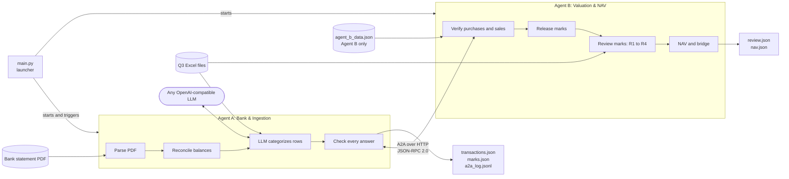
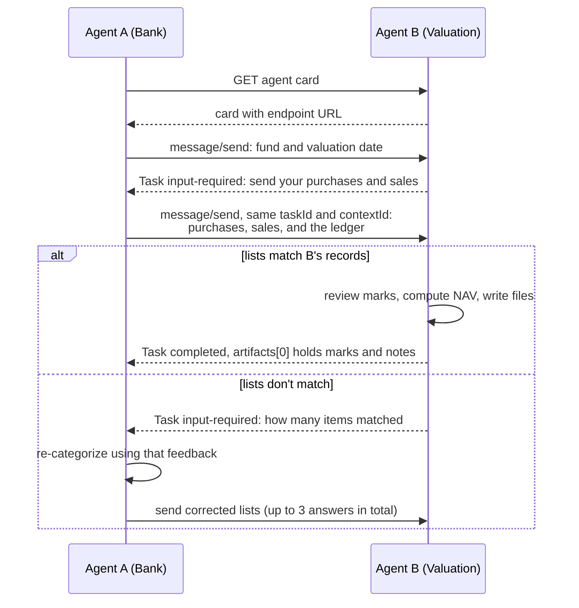
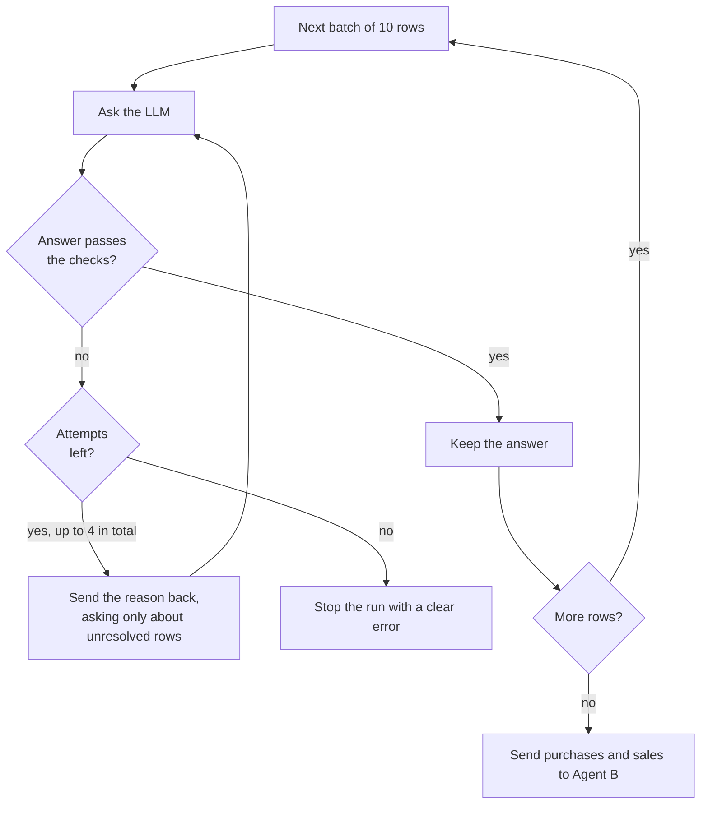
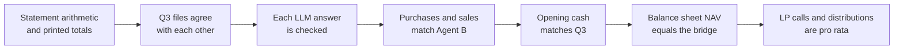

# Private Equity Quarter Close: Two AI Agents over A2A

Two agents close Q4 2022 for a private equity fund. One reads and categorizes the bank statement, the other holds the independent valuer's marks. They talk over the A2A protocol, and the run ends with a net asset value (NAV) calculated two separate ways that must agree to the cent.

```bash
python main.py ./pack
```

| Result for 31 December 2022 | |
|---|---|
| NAV | **USD 169,764,039.25** |
| NAV bridge difference | **0.00** |
| Bank transactions categorized | 39 |
| Companies flagged for review | 5 |
| Offline tests | 89 passing |

The fund, companies and bank in this exercise are all fictional. Built as a take-home for Ritamm's Software Engineering Intern role, with Claude Code as an AI assistant.

## The problem

Each quarter, a fund administrator has to work out what a fund is worth and be able to defend every figure before investors see it. The inputs live in different places and don't always line up:

- a bank statement PDF with bank-style descriptions that wrap across lines
- last quarter's numbers in Excel
- new valuations held by an independent valuer, shared only through its agent

Some of it takes judgment. A wire may not name the investor who sent it. A payment may settle last quarter's liability rather than being a new expense. One company is valued in euros, one has no valuation yet, and one was sold during the quarter.

## How it works

Each agent runs as its own process, and HTTP is the only link between them. `main.py` is only a launcher and holds no business logic.



### The A2A conversation

Agent B won't release its marks until Agent A proves that its purchases and sales match B's records. Both agents publish a card at `/.well-known/agent-card.json` and use `message/send` only.



On a normal run, `a2a_log.jsonl` holds exactly four timestamped lines: two requests and two responses.

### How the LLM is kept honest

The LLM chooses the category, LP code and company, and gives a short reason. It never produces an amount, date or reference, because those come only from the PDF. Code checks every answer, and there's no keyword fallback that could hide a failure.



| Check on each answer | What it catches |
|---|---|
| The category fits the side of the statement | A distribution booked as a credit |
| The LP code is in the register and fits the description | An invented or mismatched investor |
| The company appears in the description | A made-up company name |
| A sale must be of a company held at 30 September | The buyer named instead of the company sold |
| A settlement must match a Q3 liability, and a payment matching one by creditor and amount must be a settlement | A settlement counted as a new expense, or an expense hidden as a settlement |

The rule on sales came from testing with a real model, which named the buyer on the sale wire instead of the company sold.

## The numbers

Amounts are `Decimal` in memory and become 2-decimal numbers only in output. All values are in USD.

**NAV from the balance sheet**

| | |
|---|---:|
| Cash at bank | 23,896,579.25 |
| Investments at fair value | 146,062,460.00 |
| Accrued liabilities | (195,000.00) |
| **NAV at 31 December 2022** | **169,764,039.25** |

**NAV bridge from last quarter**

| | |
|---|---:|
| NAV at 30 September 2022 | 160,224,800.00 |
| Capital called | 20,000,000.00 |
| Distributions paid | (22,500,000.00) |
| Income (dividends and interest) | 459,429.25 |
| Expenses | (1,522,850.00) |
| Realized gain | 9,000,000.00 |
| Change in unrealized gain | 4,102,660.00 |
| **NAV at 31 December 2022** | **169,764,039.25** |
| **Difference from the balance sheet** | **0.00** |

The definitions:

- **Expenses** = management fee + other expenses paid - refunds + bank charges + Q4 accruals. Settlements of Q3 liabilities are left out because they reduce cash and a liability equally.
- **Realized gain** = sale proceeds - USD cost from the NAV summary.
- **Change in unrealized gain** = Q4 total - Q3 total, so a sold stake's Q3 gain reverses here.

Nothing adjusts the bridge. A non-zero difference fails the run.

### Layers of checks



The bridge alone isn't enough. It finds rows moved between cash-only and P&L categories, such as a settlement booked as an expense. It can't find a mistake that stays on the same side: a distribution booked as an expense lowers NAV in the bridge just the same, and a wrong LP code changes nothing in it. That's why each LP's calls and distributions are also checked as a percentage of commitment. A failed pro-rata check is reported in `nav.json` and the final summary, but doesn't stop the run on its own.

## Valuation review

| Rule | Flags when | Result on this data |
|---|---|---|
| R1 | A mark moved more than 15% from Q3, measured in the company's own currency | Bluetarn +37.50%, Cedar -31.91%, Harbor +17.83% |
| R2 | The valuation method changed | Delta: Recent transaction to Market multiples |
| R3 | The fund holds the company but has no Q4 mark | Ionmere, carried at its USD 14,000,000 cost |
| R4 | A mark exists for a company the fund doesn't hold | None. Fjord was sold, but the valuer gave a note and no mark |

Ember is the useful edge case: it fell 2.96% in euros but rose 6.18% in dollars. Only the first says anything about the company, so it isn't flagged. It converts at the ECB rate of 1.0666 from 30 December 2022, because 31 December was a Saturday. [ASSUMPTIONS.md](ASSUMPTIONS.md) explains each judgment call and what would change if it were wrong.

## Getting started

You need Python 3.11 or newer, and a key for any OpenAI-compatible LLM. A free tier such as Groq's is enough.

```bash
pip install -r requirements.txt
cp .env.example .env
python main.py ./pack
```

The pack directory is optional and defaults to `./pack` (or `PACK_DIR` if set). There are no other arguments. Results go to `./output`, and both agents stop when the run ends. The exit code is 0 only if every step worked and the bridge balanced.

Settings come from the environment or `.env`, and real environment variables win.

| Variable | Purpose |
|---|---|
| `LLM_API_KEY`, `LLM_BASE_URL`, `LLM_MODEL` | Required |
| `AGENT_A_PORT`, `AGENT_B_PORT` | Optional. Default to 8001 and 8002 |

The Git repository leaves out `pack/` and `output/`, because the pack is marked confidential. The submitted zip includes both, so a fresh clone needs the pack added before it can run.

### Tests

Tests run offline, with no LLM or network. A fake LLM stands in for the real one, and they read the real files in `./pack`.

```bash
python -m pytest
```

They also break things on purpose: corrupted balances, malformed LLM replies, invented LP codes, rejected purchase lists, and miscategorized rows that must make the bridge fail.

## Project structure

| Path | What it does |
|---|---|
| `main.py` | Starts both agents, triggers Agent A, prints the summary, stops both |
| `config.py` | Environment settings, the FX rate and the materiality threshold |
| `models.py` | The transaction shape and money helpers |
| `agents/a2a.py` | JSON-RPC server wrapper, agent cards, client, conversation log |
| `agents/bank_agent.py` | Agent A |
| `agents/valuation_agent.py` | Agent B |
| `services/pdf_parser.py` | Turns the statement into rows, using word positions |
| `services/reconciliation.py` | Balance checks |
| `services/classifier.py` | LLM client, prompt, and the checks on each answer |
| `services/verification.py` | Compares purchases and sales with Agent B's records |
| `services/q3_loader.py` | Reads the Excel files and checks they agree |
| `services/review.py` | Rules R1 to R4 and each stake's Q4 value |
| `services/nav.py` | NAV, bridge and cross-checks |
| `tests/` | The offline test suite |

Agent A never opens `agent_b_data.json`. It does read the investor list, Q3 liabilities and Q3 holdings from the NAV summary, because the LLM needs them to identify investors, settlements and what was sold. [DECISIONS.md](DECISIONS.md) records the main design choices and the alternatives I considered.

## Output files

| File | Contents |
|---|---|
| `transactions.json` | All rows, with the required fields plus the LLM's `rationale` |
| `a2a_log.jsonl` | One line per request and per response between the agents, timestamped. The launcher's trigger to Agent A and agent card fetches are not logged |
| `marks.json` | The artifact data Agent A received from Agent B, unchanged. Amounts stay as strings, as in Agent B's source file |
| `review.json` | `threshold_pct`, `eurusd_rate` and its source, then one entry per company under `companies`. `q3_fair_value` and `q4_fair_value` are in the company's own currency, and `_usd` fields are added |
| `nav.json` | The required fields, plus `management_fee`, expense and income breakdowns, holdings, per-LP activity and `checks` |

## Tested with real models

I ran the whole pipeline on Groq's free tier with `openai/gpt-oss-20b`, `openai/gpt-oss-120b` and `qwen/qwen3.8-27b`, and compared each row with the categorization I expected. All three matched on every row and gave the same NAV. A run takes one to two minutes, mostly waiting on rate limits. I have not tried other providers.

Models do get things wrong on the first try, so expect retry warnings in the log. In testing, one named the buyer instead of the company sold, and others left the company blank on the purchase. The checks caught both.

## Known gaps

- I only ran this on Windows with Python 3.13. For 3.11 I checked the syntax and that the pinned packages install, but did not run it. Linux and macOS are untested.
- The parser is built for this bank's layout. A different statement would fail with a parse error, not produce wrong rows, but it would need its own layout handling.
- The ECB rate is pinned in `config.py`. A new quarter needs a new rate.
- Only USD and EUR are supported. Any other currency stops the review.
- Fund code and valuation date are constants in `config.py`, so this closes one fund and one date.
- Agent B keeps open tasks in memory, so a restart loses them.
- The A2A endpoints have no authentication. They bind to localhost only.
- A2A coverage is `message/send` and agent cards, as the brief specifies. No streaming, `tasks/get` or push notifications.
- Categories can differ between runs or models, since an LLM picks them. The checks should stop a wrong answer from changing a number, but they don't prove every category is right. For example, a dividend booked as interest passes everything because both count as income.

## Taking it to production

1. Keep every LLM answer with its prompt and model version, and send low-confidence rows to a person for approval.
2. Put each fund's rules (categories, LP register, FX source) in data, so a new fund needs no code change.
3. Fetch and archive ECB rates with the source response, and record who approved each one.
4. Move task state to a database and add authentication between agents.
5. Add a statement layout per bank, with a test pack for each.
6. Add a review screen where an accountant clears flags before anything reaches investors.
